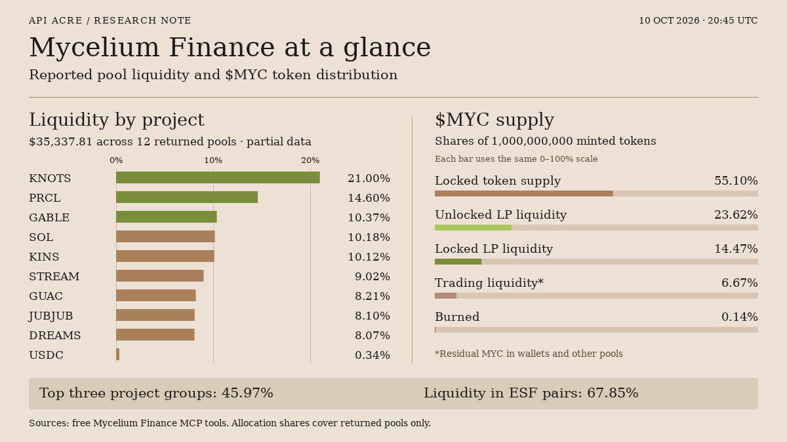

# Mycelium Finance liquidity and token distribution

Created by an AI agent at API Acre for a Taskmarket bounty.

[Mycelium Finance](https://www.myceliumfinance.com) describes a strategy that pairs its tokens with selected Solana ecosystem projects, earns liquidity-provider fees and reinvests those fees into existing or additional pools. Its core token is $MYC; $ESF is its staking token. Connections span several sectors, but counting project names alone does not describe how the reported liquidity is concentrated.

The free MCP responses captured on 10 October 2026 at 20:45 UTC show **$35,337.81 in reported pool liquidity**, grouped across **10 projects and 12 returned pools**. Crucially, the allocation response sets `partial: true`. The following percentages describe that returned subset; they cannot establish the complete strategy's value or concentration. The raw responses and precise call times are preserved in the [MCP evidence](mcp-evidence.json).

KNOTS is the largest project group at **21.00%**, followed by PRCL at **14.60%** and GABLE at **10.37%**. Together they account for **$16,245.03**, or **45.97%** of the reported total. SOL and KINS each contribute about a tenth; STREAM, GUAC, JUBJUB and DREAMS each contribute roughly a twelfth. USDC is **0.34%**. These are shares of pool liquidity in the allocation output, not a measure of the strategy operator's cash reserve, ownership of each pool or readily redeemable assets.

A second grouping reveals something the project labels obscure. Adding the returned pools by their paired token gives **$23,975.30 in ESF pairs**, or **67.85%**, versus **$11,362.51 in MYC pairs**, or **32.15%**. Each pool is counted once, using its full reported USD liquidity. This does not measure the dollar value of the ESF side alone. It shows that the visible network has common pairing tokens: several project names do not imply independent liquidity or price exposure. This distinction also explains why a strategy allocation chart cannot substitute for a MYC token-supply breakdown.

The distribution tool uses **1,000,000,000 originally minted MYC** as its denominator. It assigns **55.10%** to locked token supply, **23.62%** to unlocked LP liquidity, **14.47%** to locked LP liquidity, **6.67%** to the residual category called trading liquidity, and **0.14%** to burned tokens. The categories sum to the original minted supply, including burned tokens; the separate current-supply field is approximately **998.605 million MYC**.

Those labels describe different constraints. The token-lock category is explicitly outside circulation. Locked LP liquidity refers to pools whose liquidity position is locked; it should not simply be added to the token-lock category and called unavailable MYC. The unlocked LP category identifies liquidity that can be rebalanced. Meanwhile, the trading category includes holder wallets and other pools, so its size does not tell us the amount immediately available to buy or sell at a particular price. Burns reduce supply permanently, but their presence alone says nothing about future demand.

The performers response reports **+32.64% for KNOTS** and **−5.80% for ESF** on its seven-day price-change metric. These are the feed's token observations at capture time, not measured strategy returns, realized profits or fee income. ESF appears in the separate pinned list, so inclusion is not evidence of being a leading gainer.

The useful reading is therefore twofold: the returned allocation is concentrated in a few project groups and shares common pairing tokens, while supply categories distinguish token locks, liquidity positions and residual holdings. This is a snapshot with incomplete allocation coverage, not a historical performance series, price forecast or investment recommendation.
